# VELLARA Core Data Model v1

Status: **Proposed logical model for review; not a migration**  
Launch scope: hospitality bookings + real-estate enquiries/viewings.

## 1. Scope decision

The first release supports:
- Hotels and short-stay apartments: property discovery, room-type availability, quotes, reservations, payment verification and receipts.
- Real estate: published listings, enquiries and viewing appointments.
- Full real-estate offer negotiation, lease execution, sale closing, title transfer and legal-document workflows are out of launch scope.

This is a launch boundary, not a permanent product limitation.

## 2. Modelling rules

1. `organizations` are tenants; `properties` are individual operating locations/assets owned or managed by a tenant.
2. Hospitality and real estate share the property identity and media layer, but their commercial workflows remain separate.
3. Every tenant-owned child record carries `organization_id` and uses composite foreign keys where needed to prevent cross-tenant references.
4. UUID primary keys are used for internal identity. Human-readable references (reservation number, receipt number, listing reference) are separate unique fields.
5. Use `timestamptz` for instants, `date` for stay dates, and explicit property timezone for local operating times.
6. Money is stored as integer minor units plus ISO currency code. For GHS, 100 minor units = GHS 1.00. No floating-point money.
7. Mutable business state changes through trusted backend operations and append-only event records for financial and high-risk transitions.
8. Browser clients never choose authoritative tenant IDs, final price, availability, payment status or staff privilege.
9. Use soft archive only where history/audit requires it. Financial records and confirmed booking history are not hard-deleted.
10. Avoid speculative generic tables. Add a new entity only when it has a distinct lifecycle, authorization rule or query responsibility.

## 3. Logical ERD

```mermaid
erDiagram
  AUTH_USERS ||--o| PROFILES : has
  PROFILES ||--o{ ORGANIZATION_MEMBERSHIPS : joins
  ORGANIZATIONS ||--o{ ORGANIZATION_MEMBERSHIPS : contains
  ORGANIZATIONS ||--o{ ORGANIZATION_MODULES : enables
  ORGANIZATIONS ||--o{ PROPERTIES : owns
  PROPERTIES ||--o{ PROPERTY_STAFF_ASSIGNMENTS : assigns
  PROFILES ||--o{ PROPERTY_STAFF_ASSIGNMENTS : receives
  PROPERTIES ||--o{ PROPERTY_ASSETS : contains

  PROPERTIES ||--o{ ROOM_TYPES : offers
  ROOM_TYPES ||--o{ ROOMS : groups
  PROPERTIES ||--o{ RATE_PLANS : prices
  ROOM_TYPES ||--o{ RATE_PLANS : priced_by
  PROPERTIES ||--o{ GUESTS : serves
  GUESTS ||--o{ RESERVATIONS : makes
  PROPERTIES ||--o{ RESERVATIONS : receives
  RESERVATIONS ||--|{ RESERVATION_ITEMS : contains
  ROOM_TYPES ||--o{ RESERVATION_ITEMS : reserves
  ROOMS o|--o{ RESERVATION_ITEMS : assigned_to

  PROPERTIES ||--o{ REAL_ESTATE_LISTINGS : advertises
  REAL_ESTATE_LISTINGS ||--o{ PROPERTY_ENQUIRIES : receives
  PROPERTY_ENQUIRIES ||--o{ VIEWING_APPOINTMENTS : schedules

  ORGANIZATIONS ||--o{ RECEPTIONIST_INSTANCES : configures
  ORGANIZATIONS ||--o{ ORGANIZATION_PHONE_NUMBERS : owns
  RECEPTIONIST_INSTANCES ||--o{ CONVERSATIONS : handles
  CONVERSATIONS ||--o{ MESSAGES : contains
  CONVERSATIONS ||--o{ AI_ACTION_EXECUTIONS : records

  ORGANIZATIONS ||--o{ QUOTES : issues
  QUOTES ||--o{ QUOTE_ITEMS : contains
  QUOTES o|--o| RESERVATIONS : converts_to
  QUOTES ||--o{ PAYMENT_ATTEMPTS : initiates
  PAYMENT_ATTEMPTS ||--o| PAYMENTS : verifies_as
  PAYMENTS ||--o{ REFUNDS : may_have
  PAYMENTS ||--o| RECEIPTS : produces

  ORGANIZATIONS ||--o{ ORGANIZATION_SUBSCRIPTIONS : subscribes
  SUBSCRIPTION_PLANS ||--o{ SUBSCRIPTION_PLAN_ENTITLEMENTS : defines
  SUBSCRIPTION_PLANS ||--o{ SUBSCRIPTION_PRICES : priced_as
  ORGANIZATIONS ||--o{ ACTIVITY_EVENTS : audits
```

ERD is logical. Exact cardinalities, optionality and migration order must be reflected in the physical schema review.

## 4. Table catalogue and ownership

### A. Identity and tenant foundation

| Table | Action | Responsibility |
|---|---|---|
| `profiles` | Reuse | Auth-linked user profile; no password or auth secret |
| `organizations` | Reuse | Tenant/business account |
| `organization_memberships` | Reuse + harden | User's organization role and membership lifecycle |
| `organization_modules` | Add | Enabled modules: hospitality, real_estate |
| `platform_developer_access` | Add | Separate platform scopes, grant/revoke lifecycle |
| `property_staff_assignments` | Add | Optional narrower property-level staff scope |

Membership and platform grants are distinct. Platform developer access is never derived from email, JWT user metadata or a browser flag.

### B. Shared property layer

| Table | Action | Responsibility |
|---|---|---|
| `properties` | Add | Canonical property identity, vertical, address, timezone, slug and publication status |
| `property_assets` | Add | Private media metadata and publication state |

Initial public URL default: `/p/{organization-slug}/{property-slug}`. Both slugs are resolved together; a bare property slug is insufficient. Host mapping/custom domains are deferred.

### C. Hospitality

| Table | Action | Responsibility |
|---|---|---|
| `room_types` | Add | Sellable category and occupancy rules |
| `rooms` | Refactor | Physical room/unit assigned to property and room type |
| `rate_plans` | Add | Price, currency, per-night basis, effective period and restrictions |
| `availability_blocks` | Add | Maintenance/owner blocks independent of reservations |
| `guests` | Reuse/refactor | Organization-level guest/contact identity |
| `reservations` | Refactor | Booking aggregate and lifecycle |
| `reservation_items` | Add | One or more room-type units and optional specific room assignment |

**Allocation default:** sell against room-type inventory, assign a specific physical room later. Permit explicit room assignment when an operator needs it. Availability calculation must account for both unassigned room-type demand and assigned room overlap without double counting.

**Stay dates:** check-in inclusive, check-out exclusive. A stay from 10th to 12th occupies nights of the 10th and 11th.

### D. Real estate

| Table | Action | Responsibility |
|---|---|---|
| `real_estate_listings` | Add | Sale/rent listing and searchable commercial attributes |
| `property_enquiries` | Add | Prospect message and enquiry lifecycle |
| `viewing_appointments` | Add | Proposed/confirmed/cancelled property viewings |

A property can have multiple listings over time, but only explicitly published active listings appear publicly. Sale price, monthly rent and annual rent must have explicit price basis. No hotel stay fields are reused.

### E. Quotes, bookings and customer payments

| Table | Action | Responsibility |
|---|---|---|
| `quotes` | Add | Authoritative price and terms snapshot |
| `quote_items` | Add | Priced line items |
| `payment_attempts` | Add | Provider payment initiation and retry/idempotency |
| `payments` | Add | Verified payment ledger |
| `refunds` | Add | Refund lifecycle |
| `receipts` | Add | Immutable issued receipt snapshot |

Hospitality reservations are the booking aggregate for launch. Do not create a second generic booking table that competes with reservations. Real-estate enquiries/viewings do not become reservations.

### F. Communications and receptionist

| Table | Action | Responsibility |
|---|---|---|
| `receptionist_instances` | Reuse | AI receptionist configuration |
| `organization_phone_numbers` | Reuse | Tenant-owned phone-number inventory |
| `phone_number_channels` | Reuse | Channel/provider association |
| `receptionist_number_routes` | Reuse | Routing from inbound number/channel to receptionist |
| `calls` | Reuse/refactor | Retell voice call records |
| `call_capacity_reservations` | Reuse | Backend concurrency lease |
| `conversations` | Add | Channel-neutral conversation aggregate |
| `messages` | Add | Inbound/outbound messages and provider IDs |
| `provider_webhook_events` | Add | Signature-verified, deduplicated provider events |
| `ai_action_executions` | Add | Audited business actions authorized by VELLARA |

Retell and Meta are transport providers. OpenAI generates suggestions/structured proposals. VELLARA authorizes and executes business actions.

### G. Subscription and audit

Reuse `subscription_plans`, `subscription_plan_entitlements`, `subscription_prices`, `organization_subscriptions`, `subscription_provider_events`, and `activity_events`, subject to catalogue completion, lifecycle checks and idempotency review.

Subscription charges are separate from tenant customer booking payments.

## 5. Critical physical constraints

These are required design invariants; exact SQL names are pending detailed schema specification.

### Tenant consistency
- Composite unique key on `(organization_id, id)` for tenant parents.
- Child foreign keys include `organization_id` alongside parent ID.
- Membership uniqueness per user/organization.
- Active membership and role checks are server-enforced.

### Property identity and publication
- `properties.slug` unique within an organization.
- Public resolver joins organization + property and checks active + published state.
- Public property response uses a deliberate allowlist of fields.
- Assets require ready upload state, non-archived status and explicit publication before public delivery.

### Hospitality inventory
- `room_types` belong only to hospitality properties.
- `rooms` belong to one property and one room type from that same property.
- Room number unique within property.
- Capacity is positive and bounded.
- Rates have currency, amount, rate basis and effective interval.
- Reservation date range must satisfy check-in < check-out.
- Prevent overlapping confirmed allocations using transactional locking or exclusion constraints where applicable.
- Check-out is exclusive.
- Quote and reservation snapshots preserve terms shown to customer.

### Real estate
- Listing intent is sale or rent.
- Price amount > 0 and currency is required.
- Price basis is mandatory (sale_total, rent_monthly, rent_yearly, etc.).
- Bedrooms, bathrooms and area are typed searchable attributes.
- Viewing appointment end must be after start.
- Enquiry/viewing states have explicit transitions.

### Payments
- Amounts are positive integer minor units; currency mandatory.
- Provider references unique in their provider scope.
- Idempotency keys unique per tenant/provider operation.
- Only verified server-side provider events can settle payments.
- Receipt number unique and receipt content immutable after issue.
- Refund total cannot exceed settled refundable balance.
- No browser or AI direct mutation of payment state.

### Communications
- Provider event IDs unique per provider/account where available.
- Webhook event processing is idempotent.
- Message direction and delivery state use constrained values.
- Provider secrets are not stored in browser-readable tables.
- Conversation tenant scope is resolved from trusted route/number mapping.

## 6. Permission model to implement and test

| Role / actor | Own organization | Assigned property | Platform |
|---|---|---|---|
| Owner | Full tenant administration | All tenant properties | None by default |
| Manager | Operational/admin access within granted scope | Assigned/all per membership | None |
| Operations | Operational tasks only | Assigned properties | None |
| Verification | Explicit verification tasks only | Assigned properties | None |
| Platform developer | No implicit tenant access | No implicit property access | Only explicit platform scopes |
| Public visitor | Published public content only | Published property content | None |
| Service/backend | Only actions granted to trusted service | Validated tenant scope | Explicit service policy |

This is a proposed matrix, not a claim that current RLS implements it. Exact per-table actions (select/insert/update/delete) must be documented in a separate authorization matrix and tested with real JWT roles.

## 7. State machines

### Property
`draft -> active -> inactive -> archived` (publication is a separate state/flag; activating a property must not automatically publish it).

### Asset
`pending_upload -> uploaded_unverified -> ready -> archived`. Publication is allowed only for ready assets and is a separate boolean/timestamp.

### Reservation
`pending -> confirmed -> checked_in -> checked_out`; cancellation and no-show are explicit terminal/side paths. Exact allowed transitions and hold expiry are server-owned.

### Payment attempt
`created -> pending -> succeeded | failed | expired | cancelled`. A verified payment record is separate from an attempt. Webhook replay cannot duplicate settlement.

### Listing
`draft -> published -> paused -> closed/archived`. Enquiry/viewing lifecycle is separate.

### Viewing
`requested -> proposed -> confirmed -> completed`; cancellation/rejection/no-show are explicit outcomes.

## 8. Decisions adopted as v1 defaults

- Launch: hospitality booking + real-estate enquiry/viewing only.
- Public URL: path-based organization + property slug.
- Hospitality: room-type inventory first, with later/specific room assignment supported.
- Guest identity: organization-level contact, property-scoped reservation history.
- Real-estate transaction closing: deferred.
- Money: integer minor units + explicit currency.
- Public content: published-only resolver.
- Media: private Storage bucket, backend-issued upload intent, server verification, explicit publish.
- API: typed backend contracts; no frontend-invented routes or privileged direct writes.
- Production changes: none until staging migration replay and security tests pass.

## 9. Remaining decisions before SQL

1. Booking hold duration and whether unpaid holds consume inventory.
2. Whether payment at launch supports Paystack only, Pay at property, or both.
3. Cancellation/refund policy configuration and whether owners can define it per property/rate plan.
4. Tax/fee calculation ownership and Ghana tax treatment; do not assume a rate.
5. Whether multiple room units can be purchased in one reservation at launch (model supports it; UI may initially limit it).
6. Retention period and consent/notice requirements for calls, transcripts and WhatsApp messages.
7. Final exact permission matrix for Owner, Manager, Operations and Verification.

## 10. Next engineering steps

1. Review the live table definitions against this logical model, especially current `rooms`, `reservations`, `guests`, memberships and subscription tables.
2. Reconcile existing open PR #29/#31/#32 dependencies before taking any schema SQL from them.
3. Produce a migration-by-migration plan with explicit backfill and rollback/recovery strategy.
4. Build the authorization matrix and RLS test cases.
5. Create a separate Supabase staging project and replay migrations there.
6. Only after successful staging tests, request approval for production migration execution.

**This document is not executable SQL and has not changed the live database.**
